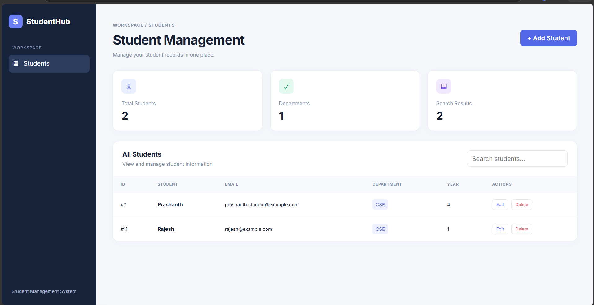
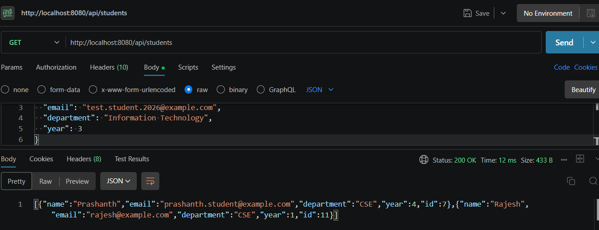
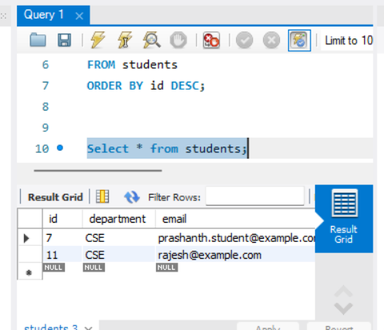

# Student Management System

A full-stack web application for managing student records, built with React, Java Spring Boot, and MySQL.

## Overview

The Student Management System provides a dashboard to create, view, update, delete, and search student records. The React frontend communicates with a Spring Boot REST API, while MySQL stores the student information.

## Features

- Create new student records
- View all students and individual student details
- Update existing student information
- Delete student records
- Search by student name, email, or department
- Responsive dashboard with student statistics
- REST API integration
- Persistent data storage with MySQL

## Technology Stack

| Layer | Technologies |
|---|---|
| Frontend | React, Vite, JavaScript, CSS |
| Backend | Java 21, Spring Boot |
| Persistence | Spring Data JPA, Hibernate |
| Database | MySQL |
| API Testing | Postman |
| Version Control | Git, GitHub |
| Build Tool | Maven |

## Project Structure

```text
Student_Management_System/
├── README.md
├── .gitignore
└── student-management-system/
    ├── frontend/
    │   ├── src/
    │   ├── package.json
    │   └── vite.config.js
    ├── src/
    │   ├── main/
    │   │   ├── java/com/studentmanagement/
    │   │   └── resources/
    │   └── test/
    ├── pom.xml
    └── mvnw.cmd
```

## Prerequisites

Install the following software:

- JDK 21
- Node.js and npm
- MySQL Server
- Git

## Getting Started

### 1. Clone the repository

```bash
git clone https://github.com/Prashanthpower/student-management-system.git
cd student-management-system
```

### 2. Configure MySQL

Create the database in MySQL Workbench:

```sql
CREATE DATABASE student_management;
```

Configure the following environment variables before starting the backend:

- `DB_URL` — `jdbc:mysql://localhost:3306/student_management`
- `DB_USERNAME` — your MySQL username
- `DB_PASSWORD` — your MySQL password

Never commit real database credentials to GitHub.

### 3. Run the Spring Boot backend

Open a terminal in the `student-management-system` directory.

On Windows PowerShell, set the environment variables:

```powershell
$env:DB_URL="jdbc:mysql://localhost:3306/student_management"
$env:DB_USERNAME="root"
$env:DB_PASSWORD="YOUR_MYSQL_PASSWORD"
```

Replace the placeholder with your local MySQL password.

Start the backend:

```powershell
.\mvnw.cmd spring-boot:run
```

The backend runs at:

`http://localhost:8080`

### 4. Run the React frontend

Open a second terminal in the `student-management-system/frontend` directory.

Install dependencies and start the development server:

```bash
npm install
npm run dev
```

Open the local URL displayed by Vite, usually:

`http://localhost:5173`

Ensure the Spring Boot backend is running and CORS is configured for the frontend origin.

## REST API Endpoints

Base URL: `http://localhost:8080/api/students`

| HTTP Method | Endpoint | Description |
|---|---|---|
| POST | `/api/students` | Create a student |
| GET | `/api/students` | Retrieve all students |
| GET | `/api/students/{id}` | Retrieve a student by ID |
| PUT | `/api/students/{id}` | Update a student |
| DELETE | `/api/students/{id}` | Delete a student |

### Example request

Create a student using `POST /api/students` with a JSON body:

```json
{
  "name": "Test Student",
  "email": "test.student@example.com",
  "department": "Computer Science",
  "year": 2
}
```

Each student email must be unique.

## Testing

The REST API has been tested using Postman for create, read, update, and delete operations. Frontend operations have also been tested against the running backend and database.

## Future Enhancements

- Improved server-side validation and error handling
- Pagination and sorting
- Authentication and authorization
- Automated backend and frontend tests
- Production deployment

## Author

**Prashanth**

GitHub: [Prashanthpower](https://github.com/Prashanthpower)

---

This project was developed as a practical full-stack development project to gain experience with Java, Spring Boot, React, REST APIs, and relational databases.


## Screenshots

### Student Dashboard


### REST API


### MySQL Database


## 🌐 Live Demo

- **Frontend (Student Management System):** [Open Application](https://student-management-frontend-svvd.onrender.com)
- **Backend API (Students):** [View Students API](https://student-management-system-1lff.onrender.com/api/students)

